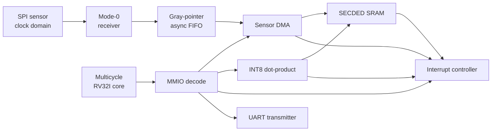
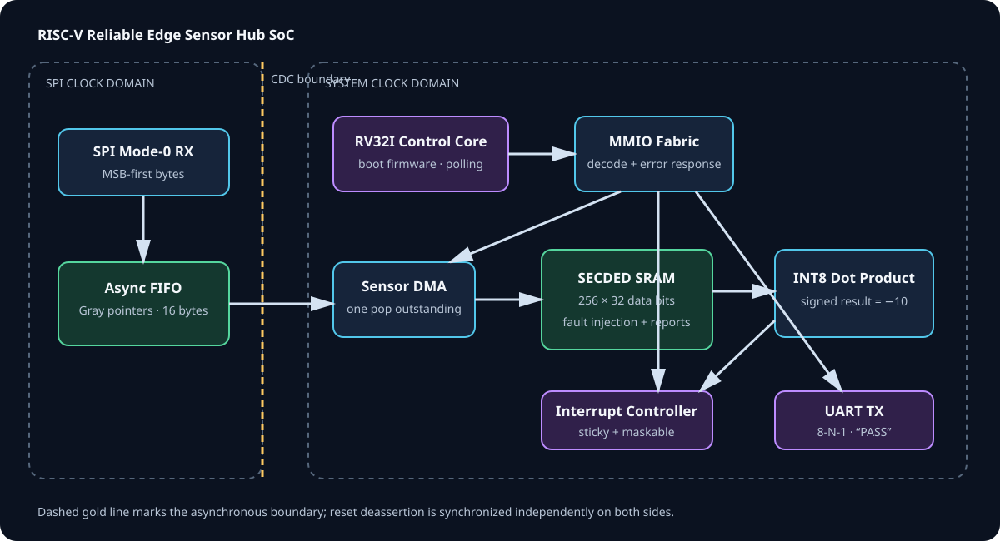

# RISC-V Reliable Edge Sensor Hub SoC

[](https://github.com/ashishkommineni/riscv-edge-sensor-hub-soc/actions/workflows/ci.yml)

A firmware-controlled SystemVerilog SoC demonstrator that moves asynchronous
SPI sensor samples into SECDED-protected memory, processes them with a signed
INT8 dot-product engine, raises interrupts, and reports completion over UART.

This repository is intentionally one coherent product, not a folder of unrelated
IP examples. Its main verification question is:

> Can eight sensor samples cross a real clock-domain boundary, reach protected
> memory through DMA, survive an injected single-bit storage fault, produce the
> correct signed result, and be observed by firmware without silent corruption?

The deterministic demonstration answers that question with samples `1..8` and
weights `[1,-1,2,-2,3,-3,4,-4]`, whose expected dot product is `-10`.

## Architecture





The CPU runs the checked-in [`firmware/boot.hex`](firmware/boot.hex). It enables
interrupt sources, configures DMA, polls completion, starts the accelerator,
polls its result, writes `PASS\n` to UART, and executes `EBREAK`. IRQ is exposed
and verified as a system output; this teaching CPU does **not** implement machine
CSRs or an interrupt trap/return path, so the firmware uses polling rather than
claiming an interrupt service routine.

## End-to-end flow

1. Asynchronous reset asserts immediately. Deassertion is synchronized separately
   in the system and SPI clock domains.
2. The SPI mode-0 receiver samples MOSI on rising SCLK edges and emits one byte
   for every eight bits while chip select is low.
3. A 16-entry Gray-pointer FIFO crosses bytes into the system clock domain.
4. Firmware programs an eight-byte DMA transfer to `0x1000_0000`.
5. DMA issues exactly one FIFO pop, waits for its registered response, then writes
   one zero-extended byte per 32-bit protected SRAM word.
6. The testbench flips a **data bit** in the first 39-bit SECDED codeword.
7. The accelerator reads eight signed bytes. SECDED corrects the injected bit and
   reports the correction; the mathematical result remains `-10`.
8. Completion sources become pending interrupts. The UART accepts `PASS\n`, and
   the CPU halts without a fault.

The corresponding expected signal order is shown in
[`assets/waveform.svg`](assets/waveform.svg).

## What is implemented

| Area | Implemented behavior |
|---|---|
| CPU | Small multicycle RV32I control core: LUI/AUIPC, jumps, branches, integer ALU, byte/half/word loads and stores, FENCE no-op, EBREAK/ECALL halt |
| Firmware | Deterministic 35-word bare-metal image plus a dependency-free image generator |
| Sensor path | SPI mode-0 receive-only slave and 16-byte asynchronous FIFO |
| CDC/reset | Gray-pointer synchronizers, overflow pulse synchronizer, async-assert/sync-deassert resets per domain |
| DMA | Configurable destination and length, registered FIFO handshake, completion/error status |
| Memory | 256 × 32-bit SECDED SRAM with byte writes, correctable/uncorrectable reporting, fault injection |
| Accelerator | Signed INT8 dot product with eight repeating signed coefficients |
| Interrupts | Five sticky, maskable sources with write-one-to-clear pending bits |
| UART | 8-N-1 serial transmitter and accepted-byte observation port |
| Verification | Self-checking SV test, executable Python reference/ECC models, SVA source, portable coverage gates, UVM 1.2 environment source |

## Register and memory map

| Address range | Block | Notes |
|---|---|---|
| `0x0000_0000–0x0000_03FF` | Boot ROM | Instruction-side, 256 words |
| `0x1000_0000–0x1000_03FF` | ECC SRAM | Exactly 1 KiB; aligned out-of-range accesses fault |
| `0x2000_0000–0x2000_0FFF` | SPI/FIFO status | Empty/full/overflow/underflow observation |
| `0x2000_1000–0x2000_1FFF` | DMA | Control/status, destination, length, count |
| `0x2000_2000–0x2000_2FFF` | Accelerator | Control/status, source, length, index, result |
| `0x2000_3000–0x2000_3FFF` | Interrupt controller | Pending/W1C and mask |
| `0x2000_4000–0x2000_4FFF` | UART | TX data and busy status |

DMA and accelerator offset `+0x00` uses one consistent control/status layout:

| Bit | Read meaning | Write meaning |
|---|---|---|
| 0 | ACTIVE | START (one) |
| 1 | DONE | CLEAR_DONE (one) |
| 2 | ERROR | CLEAR_ERROR (one) |
| 3 | IRQ_ENABLE | New IRQ_ENABLE value |

See [`docs/memory_map.md`](docs/memory_map.md) for every register and access rule.

## Run the portable checks

Requirements: Python 3, GNU Make, and Verilator 5 or later for RTL simulation.

```bash
make check       # firmware freshness + executable reference/ECC model + structure
make lint        # Verilator RTL lint
make sim         # build and run the self-checking SystemVerilog test
make all         # all of the above
```

Expected terminal ending:

```text
PASS
SOC_TEST_PASS result=-10 uart=PASS dma=1 acc=1 irq=1 ecc_corrected=1 cycles=<value>
```

`results/soc.vcd` is produced by the portable test. The exact cycle count is not
part of the contract; the end-to-end data, event, error, and UART checks are.

For Cadence Xcelium with UVM 1.2:

```bash
make xcelium
```

That target is prepared for an installation with `xrun` on `PATH`. The UVM source
has **not been run in Xcelium** in this workspace, so no Xcelium pass or coverage
number is claimed. Preserve the transcript, seed, tool version, assertion summary,
and IMC coverage report when that run is performed.

## Verification strategy

The portable test is not a print-only smoke test. It fails unless all of these are
observed:

- firmware reaches `EBREAK` without the CPU fault output;
- DMA and accelerator completion both occur;
- at least one enabled interrupt is observed;
- a data-bit injection is reported as correctable;
- no uncorrectable error occurs at any time;
- the corrected dot product is exactly `-10`;
- the accepted UART byte stream is exactly `PASS\n`.

The Python reference model independently interprets the checked-in machine code,
models the MMIO sequence, and exhaustively flips every one of 39 bits for five
representative SECDED codewords. It also checks double-bit detection. This catches
stale firmware, incorrect branches, inconsistent register addresses, and ECC
equation mistakes before a simulator job.

SVA in `rtl/soc/soc_assertions.sv` checks bounded CPU responses, monotonic DMA
progress, and the absence of dual-writer memory collisions. The UVM environment
adds constrained SPI items, an active agent, end-to-end scoreboard, coverage
subscriber, and Xcelium top. Detailed targets and exclusions are in
[`docs/verification_plan.md`](docs/verification_plan.md).

## Repository structure

```text
rtl/        synthesizable CPU, CDC, DMA, ECC SRAM, peripherals and SoC top
firmware/   readable assembly and checked-in machine image
tb/         portable self-checking SystemVerilog testbench
dv/         UVM 1.2 agent, environment, scoreboard, coverage, tests and top
docs/       specification, memory map, verification plan/report, interview notes
assets/     version-controlled architecture and timing visualizations
scripts/    deterministic firmware generator and executable reference checks
sim/        portable and Xcelium file lists
results/    expected-output contract; generated waveforms/logs are ignored
```

## Engineering boundaries

This is a portfolio-quality educational MVP, not a tape-out-ready SoC.

- The CPU is **not an ISA-compliance** certified core. It has no privileged ISA,
  CSRs, exceptions, compressed instructions, caches, or interrupt trap handling.
- The generic dual-clock FIFO and synchronizer attributes demonstrate correct RTL
  architecture, but this is **not a silicon CDC sign-off**. A real flow still needs
  structural CDC/RDC analysis, synchronizer constraints, MTBF calculation, and
  target-library RAM review.
- The SRAM model uses initialization and combinational reads for portability.
  ASIC implementation requires a technology memory macro and wrapper equivalence.
- SECDED corrects single-bit errors and flags detected double-bit errors. Like any
  SECDED code, some faults involving more than two flipped bits can be miscorrected.
- The accelerator has fixed coefficients to keep the firmware and expected result
  deterministic. A production revision would provide coefficient memory.
- The SPI block is a receive-only mode-0 path. It is not a full SPI controller.
- No PPA, timing closure, formal proof, Xcelium regression, or coverage-closure
  percentage is claimed without a preserved tool report.

## Interview explanation

> “I built a small RISC-V-controlled sensor SoC around one end-to-end reliability
> path. SPI samples arrive in an unrelated clock domain, so I cross them through a
> Gray-pointer asynchronous FIFO. Firmware configures DMA to place each sample in
> SECDED SRAM. The test injects a data-bit fault, the memory corrects it, and a
> signed INT8 engine still produces the expected result. I verify the system at
> three levels: an independent Python architectural model, a self-checking RTL test
> with assertions and coverage gates, and a UVM environment prepared for Xcelium.
> I also document the limits: the CPU is a control subset, IRQ is observed but
> firmware polls, and the CDC requires target-flow sign-off.”

The strongest discussion point is not the number of blocks. It is the traceable
chain from specification to firmware action, clock-domain crossing, stored data,
fault response, arithmetic result, interrupt event, and externally visible UART.

## License and provenance

All repository RTL and verification source is original educational work released
under the MIT License. No third-party RISC-V core or vendor memory model is copied
into this repository. RISC-V is used as an instruction-set architecture name; the
project is not endorsed or certified by RISC-V International.

See [`docs/provenance.md`](docs/provenance.md) for the ownership boundary and
recommended path to replace the teaching CPU with a separately licensed core.
